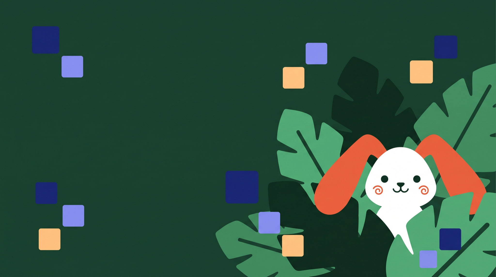

# Table of Squares 2.0

A full remake of a school project: an iPhone app for learning the squares of numbers from 10 to 99.
The first version was written in 2019 in 9th grade, in UIKit, without AI. This one is SwiftUI from scratch.

<p align="center"></p>

## What is inside

- **Field 10–99.** Every square is a cell. Answer it right on three different days and it is yours. Without practice it starts to fade, which is spaced repetition you can see.
- **Race.** 20 squares against your own best run (the ghost) or three bots: Turtle, Owl and Robot.
- **Duel.** Two players on one phone, the screen split in half.
- **Lessons.** Four mental math tricks shown step by step: numbers ending in 5, close to 50, close to 100 and the "next door" trick.
- **Cards, Reverse mode, the visual square and the full table.**
- **Trophies, streaks, a home screen widget** with the square of the day and a shareable race record card.
- Haptics and synthesized sounds on every interaction. 53 languages.

## Build

```sh
brew install xcodegen
xcodegen generate
open TableOfSquares.xcodeproj
```

Launch arguments for screenshots and tests: `-demo` (filled profile), `-fresh` (empty profile), `-done` (whole field captured).

## Tests

```sh
xcodebuild test -project TableOfSquares.xcodeproj -scheme TableOfSquares \
  -destination 'platform=iOS Simulator,name=iPhone 17 Pro' -enableCodeCoverage YES
```

- Unit tests: the field and spaced repetition, streaks, races, achievements, saving, every trick's arithmetic.
- `LocalizationTests`: every language has every string, placeholders intact, no emoji.
- `ButtonFitTests`: every button caption in every language fits on a 375 pt wide iPhone.
- `SourceHygieneTests`: no emoji anywhere in the sources.
- UI tests: `FlowTests` play through every screen end to end; `LayoutTests` walk the screens in all languages, check nothing sticks out of the screen and save screenshots (`TEST_RUNNER_SHOTS=/path`).

## Translations

UI strings are collected from the compiler (`tools/strings.py`), translated in `tools/tr/<lang>.json`, validated by `tools/check_tr.py` and compiled into String Catalogs by `tools/build_catalog.py`.

Illustrations were generated for this project and live in the asset catalog.
